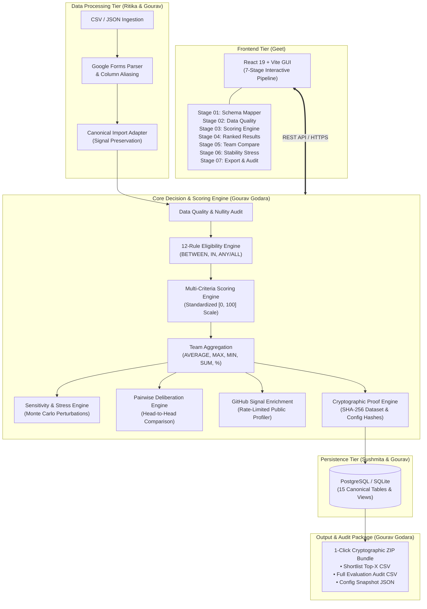
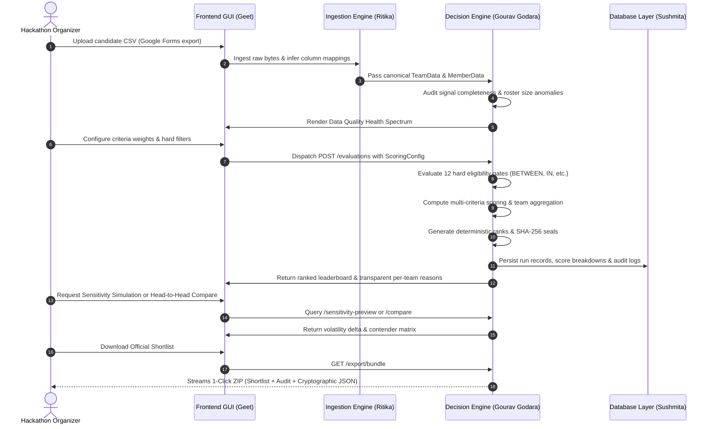

# ShortlistIQ: System Architecture & Engineering Ownership Record

**Project:** Team Recruitment Automation Tool (Hackathon Track 3)  
**Version:** `2.0.0` (Production Ready)  
**Architecture:** Decoupled Micro-Pipeline (React 19 Frontend + FastAPI Core Decision Engine + PostgreSQL / SQLite)  

---

## 1. System Architecture Overview

---

## 2. End-to-End Pipeline Data Flow

---

## 3. Engineering Roles & Contributor Matrix

| Contributor | Domain & Focus | Key Modules Authored & Integrated |
|---|---|---|
| **Gourav Godara** | **Core Backend & Decision Engine** | • **Core Decision Engine:** Designed the multi-criteria scoring pipeline operating on a normalized `[0, 100]` scale with dynamic weight redistribution for partial data. • **Team Aggregation Strategies:** Built 5 distinct mathematical aggregations (`AVERAGE`, `MAX`, `MIN`, `SUM`, `PERCENTAGE`) with team-size normalization to keep solo and 5-member teams on an equal footing. • **Declarative Rule Engine:** Built 12 configurable hard gates (including `BETWEEN`, `IN`, `EXISTS`, `NOT_IN`) with deterministic three-valued logic (`PASS`, `FAIL`, `INSUFFICIENT_DATA`, `FLAGGED`). • **Automated Data Quality Audit:** Created `data_quality_service.py` to audit completeness, detect solo/oversized roster anomalies, and identify broken profiles. • **Sensitivity & Stress Engine:** Created `sensitivity_service.py` to simulate weight perturbations and compute bubble-zone volatility. • **Pairwise Deliberation Engine:** Created `comparison_service.py` for head-to-head tie breaking. • **Developer Signal Enrichment:** Built `github_service.py` with caching and suspicious activity detection (forks, empty repos). • **Cryptographic Verification & Exports:** Created `export_service.py` generating SHA-256 dataset/config hashes, CSV exports, and 1-Click ZIP bundles. • **API & Deployment:** Built the FastAPI REST routes, CORS middleware, `Procfile`, `render.yaml`, and the **146-test automated test suite** (0.35s execution). |
| **Ritika** | **Data Ingestion & Normalization** | • **Canonical Ingestion Schemas:** Designed canonical Pydantic data schemas (`TeamData`, `MemberData`, `ImportResult`). • **Parsers & Column Aliasing:** Created Google Forms CSV/JSON parsers with fuzzy column-name mapping dictionary. • **Signal Sanitization:** Built initial link validation and string normalization utilities. |
| **Sushmita** | **Database & Persistence Architecture** | • **Relational Schema Design:** Authored the 15-table PostgreSQL DDL migration scripts (`database/migrations/001_initial_schema.sql`). • **Data Models:** Designed relational tables for campaigns, datasets, teams, criteria signals, runs, and audit logs. • **Supabase Configuration:** Configured initial role permissions and database connection sequences. |
| **Geet** | **Frontend Engineering & UI/UX** | • **Interactive 7-Stage Pipeline GUI:** Built the complete React 19 + Vite 8 frontend application (`frontend/src/`). • **Visual Component Suite:** Created the Schema Mapping table, Data Quality Spectrum, Criteria Multiplier Sliders, Ranked Results Table, Contender Deliberation Matrix, and Export Dock. • **Client Integration:** Implemented state synchronization and API client bindings in `client.js`. |

---

## 4. Key Technical Highlights for Interviews (Gourav Godara)

When discussing this project in engineering interviews, you can reference this system design:

1. **Deterministic Three-Valued Logic:**
   - Separated missing data from invalid inputs (`PRESENT`, `MISSING`, `INVALID`, `FLAGGED`) so that teams with partial profile links are never crashed or unfairly penalized without organizer transparency.
2. **Team-Size Bias Mitigation:**
   - Designed 5 aggregation algorithms ensuring solo participants and large teams are evaluated fairly without hardcoded score inflation.
3. **Cryptographic State Sealing:**
   - Implemented dual SHA-256 hashes (`dataset_hash` + `config_hash`) ensuring that any shortlist can be cryptographically verified months later for compliance and anti-tampering audits.
4. **Automated Verification:**
   - Authored an end-to-end automated test suite containing 146 test cases executing in 0.35 seconds with zero external network dependencies.
